# Twisted Metal (2012) – 4K Remaster Gesamtdossier

**Stand:** 17. Oktober 2026  
**Projekt:** Twisted Metal (PS3, BCUS98106 v01.06) – Native 4K Rekonstruktion (3840×2160), 60 FPS, 5.000m Weitsicht & Stabilitäts-Remaster auf RPCS3  
**Autoren:** Ein leidenschaftlicher Fan in Zusammenarbeit mit Google DeepMind Gemini (Gemini 3.1 Flash / Antigravity) und ChatGPT (Codex SOL 6.1)  

---

## 🧭 Visuelle Ablauf-Übersicht (Mindmap)

```mermaid
flowchart TD
    subgraph VOR["1. VORAUSSETZUNGEN (Was du brauchst)"]
        V1["Twisted Metal PS3 Disc / ISO (BCUS98106 - USA)"]
        V2["Offizielle Sony PS3 Game-Updates (v01.01 bis v01.06)"]
        V3["Windows 10/11 PC + dedizierte GPU (NVIDIA RTX / AMD Radeon RX / Intel Arc)"]
        V4["Build-Tools: VS Build Tools 2026, Qt 6.9, CMake 3.28+, Python 3"]
    end

    subgraph PROMPT["2. DER INSTALLATIONSWEG (Empfehlung: KI-Master-Prompt)"]
        P1["Master-Prompt (02_PROMPT_FUER_KI_NEUBAU.md) kopieren"]
        P2["An einen KI-Agenten übergeben (z. B. ChatGPT Codex oder Gemini Antigravity)"]
    end

    subgraph PIPELINE["3. WAS DIE KI VOLLAUTOMATISCH IM HINTERGRUND AUSFÜHRT"]
        S1["Phase 1-2: Sauberes RPCS3 klonen & TM4K-Overlay/C++ Patches integrieren"]
        S2["Phase 3: Release x64 kompilieren (rpcs3.exe) & windeployqt ausführen"]
        S3["Phase 4: 5x TM4K-Flags & 4K-Config (300% Scale, Async Texture: false) einrichten"]
        S4["Phase 5: SPU/PPU-Patches platzieren (11x NOP SPU-Bypass an 0x0066aaf4)"]
        S5["Phase 6: Asset-Patcher ausführen (5.000m Weitsicht & Anti-Blur in times.psarc)"]
        S6["Phase 7: Starter-Skript (Start-TwistedMetal-4K.ps1) mit 7x EnvVars erzeugen"]
        S7["Phase 8: Automatisierter 8-Punkte-Systemcheck (Verify-TM4K-Setup.ps1)"]
    end

    subgraph READY["4. ERFOLG: SPIELSTART & GENIESSEN"]
        R1["Release v1.0: 4K UHD Master (3840x2160, bis zu 60 FPS)"]
        R2["(Native 1080p/1440p Handheld-Profile folgen als Roadmap-Updates)"]
        R3["Unter RPCS3 'Pads' eigenes Gamepad wählen (Xbox / PS5 / PC)"]
        R4["Twisted Metal in nativer Brillanz & 5km Weitsicht erleben!"]
    end

    VOR --> PROMPT
    PROMPT --> S1
    S1 --> S2
    S2 --> S3
    S3 --> S4
    S4 --> S5
    S5 --> S6
    S6 --> S7
    S7 --> R1
    R1 --> R2
    R2 --> R3
    R3 --> R4
```

---

## ⚡ Wichtige Empfehlung: Installation über den KI-Master-Prompt!

> [!IMPORTANT]
> **Installiere dieses Projekt am besten über den Master-Prompt für KI-Agenten:**  
> 👉 **[02_PROMPT_FUER_KI_NEUBAU.md](02_PROMPT_FUER_KI_NEUBAU.md)**
>
> Die manuelle Schritt-für-Schritt-Anleitung existiert als Referenz für Entwickler. Der **KI-Master-Prompt** hingegen wurde von Grund auf in der Praxis gegen **zwei völlig unabhängige KI-Agenten-Systeme** gegengeprüft und verifiziert:
> 1. **Google DeepMind Gemini (Gemini 3.1 Flash / Antigravity)**
> 2. **OpenAI ChatGPT Codex (Codex SOL 6.1)**
>
> Beide Agenten haben diesen Mod-Build auf einem frischen Verzeichnis völlig autonom und ohne manuelles Eingreifen auf Anhieb fehlerfrei kompiliert, gepatcht, konfiguriert und über den 8-Punkte-Selbstcheck validiert.

---

## 🎮 Voraussetzungen & Versionen

1. **Spiel-Version:**  
   * **Twisted Metal (PS3)** – US-Version (Produktcode: `BCUS98106`).
2. **Offizielle Sony Game-Updates (v01.01 bis v01.06):**  
   * Das Spiel muss zwingend auf Version **v01.06** gepatcht sein.
   * Die Updates können direkt und legal über Sonys offizielle Content-Server (bzw. über RPCS3: Rechtsklick auf das Spiel ➔ *Manage Game Patches* / *Check for Updates*) heruntergeladen und als `.pkg` in RPCS3 installiert werden.
   * *Hintergrund:* Unser 11x NOP SPU-Bypass (`0x0066aaf4`), der 60-FPS-Patch und die Weitsicht-Deltas sind mathematisch auf die `EBOOT.BIN` der Version 01.06 kalibriert.
3. **Hardware:**  
   * Beliebiger moderner PC mit 6+ Kernen (AMD Ryzen oder Intel Core).
   * Dedizierte Grafikkarte mit Vulkan 1.3 Unterstützung (NVIDIA GeForce RTX, AMD Radeon RX oder Intel Arc).
4. **Build-Umgebung (wird von der KI autonom genutzt):**  
   * Visual Studio 2026 Build Tools (C++ x64 Toolchain)
   * CMake 3.28+
   * Qt 6.8+ oder 6.9+
   * Python 3.10+ (Standardbibliothek)

---

## 🎯 Release v1.0 Fokus: 4K Master & Auflösungs-Roadmap

* **4K UHD Master-Standard (v1.0):**  
  Der vorliegende Release ist die bis ins letzte Detail ausgereifte und auf Herz und Nieren geprüfte **4K-Referenzversion** (`Resolution Scale: 300` = 3840×2160). Hier greifen alle TM4K-Compute-Shader, die Weitsicht-Deltas und die HDR-Fusionspipelines perfekt ineinander.
* **Für 1080p- und 1440p-Monitore (Super-Sampling / SSAA):**  
  Wer einen Full-HD- oder WQHD-Monitor besitzt, kann die 4K-Version direkt auf seiner PC-Grafikkarte ausführen! RPCS3 rendert intern in 4K und gibt das Bild mit brillanter Glättung via **Super-Sampling Anti-Aliasing (SSAA)** auf dem Bildschirm aus – ohne Treppeneffekte an Zäunen und Strommasten und mit voller Shader-Pracht.
* **Roadmap für mobile Handhelds (Steam Deck / ROG Ally / Legion Go):**  
  Eigene native Performance-Profile für 1080p und 1440p mit speziell herunterskalierten Compute-Shadern für mobile APUs befinden sich in der Entwicklung und werden schrittweise in kommenden Updates nachgereicht. Der aktuelle Fokus liegt voll und ganz auf der perfekten 4K-Erfahrung!

---

## 🎮 Controller-Einbindung: Individuell & Zuverlässig

* **Kein Überschreiben bestehender Profile:**  
  Das System überschreibt niemals vorhandene RPCS3-Controllerkonfigurationen. Falls RPCS3 bereits genutzt wird, bleiben alle Gamepad- oder Lenkrad-Zuordnungen unberührt.
* **Ersteinrichtung:**  
  Unter `Pads` in RPCS3 weist der Nutzer (oder die KI) den Controller individuell zu (`Player 1` ➔ `Handler: XInput` / `DualSense` ➔ Gerät auswählen ➔ `Save`).
* **Wichtiger Schutz vor Controller-Entkoppelung:**  
  RPCS3 wird regulär über die GUI beendet und niemals mit `--no-gui` abgewürgt. Dies verhindert Phantom-Handles im Windows-Kernel, durch die sich drahtlose Gamepads (z. B. Xbox Wireless Controller) nach wenigen Sekunden selbst abschalten würden. Sollte ein Controller dennoch einmal blockieren: In PowerShell einfach `Restart-Service XboxGipSvc, GameInputRedistService` ausführen (kein PC-Neustart erforderlich!).

---

## 💬 Persönliches Vorwort des Initiators: Die Kraft der KI-Agenten

> *"Ich bin kein Programmierer. Ich habe keine Zeile C++ gelernt und ich habe nicht einmal RPCS3 selbst installiert – all das haben die KI-Agenten gemacht. Was ich hatte, war eine Vision, tiefe Leidenschaft für Twisted Metal und unendliche Hartnäckigkeit.*
>
> *Über drei Wochen lang habe ich Tag für Tag Stunden in dieses Projekt gesteckt. Ich habe unzählige Testläufe gefahren, jedes noch so feine Detail beobachtet und die Puzzleteile zusammengefügt: das subtile Grieseln auf dem Wüstensand, den schwarzen Asphalt in schnellen Kurven, das 30-Hz-Flackern der Flammen auf Sweet Tooths Maske, die türkisen Farbverschiebungen und die Bluetooth-Entkoppelung moderner Controller.*
>
> *Ich habe diese Beobachtungen und Zusammenhänge den Agenten zurückgemeldet, gemeinsam mit ihnen Hypothesen aufgestellt, verworfen und den Code Schritt für Schritt verfeinert.*
>
> *Manche Leute denken vielleicht: ‚Das wurde ja alles nur mit KI gemacht, da steckt ja keine Arbeit drin.‘ Dem widerspreche ich entschieden: Hinter diesem Remaster stecken Wochen intensiver menschlicher Testarbeit, unzählige Denkprozesse, Durchhaltevermögen und nicht zuletzt echtes Geld für die Rechen-Credits der Agenten.*
>
> *Ein riesiges Dankeschön und tiefster Respekt gebühren **Google DeepMind Antigravity (Gemini)** und **OpenAI ChatGPT Codex**! Agenten sind die absolute Zukunft – insbesondere im Gaming- und Modding-Bereich. Sie ermöglichen es Fans wie mir, Dinge zu erschaffen, die früher ganzen Entwicklerteams vorbehalten waren."*

---

## 📌 Schnellzugriff auf alle Projektdokumente

1. **[00_ARCHITEKTUR_UND_KOMPONENTEN_ZUORDNUNG.md](00_ARCHITEKTUR_UND_KOMPONENTEN_ZUORDNUNG.md)** 🗺️  
   *Das 5-Säulen-Architekturmodell & Komponenten-Atlas:* Detaillierte Zuordnung jeder Datei und jedes Schalters (RSX-Core, PS3-Binärpatches, Host-Config, Level-Assets, Input), inklusive Hardware-Kompatibilitäts-Matrix (AMD/NVIDIA/Intel) und ganzheitlichem Fehlersymptom-Atlas.

2. **[01_PROJEKTCHRONIK_UND_HISTORIE.md](01_PROJEKTCHRONIK_UND_HISTORIE.md)**  
   *Die gesamte Entstehungsgeschichte:* Von den zahllosen Fehlversuchen bis zu den 9 großen Meilensteinen (4K-Schichten-Isolation, Sicherheitsrahmen-Beseitigung, Sweet-Tooth-Flammen, Ramming-Fix, Aufdeckung des HierLOD-Bodenfehlers, Beruhigung des Sandes, Controller-Autonomie und 8-Punkte-Validierung).

3. **[02_PROMPT_FUER_KI_NEUBAU.md](02_PROMPT_FUER_KI_NEUBAU.md)** ⭐⭐ *(EMPFOHLEN)*  
   *Schlüsselfertiger Master-Prompt für KI-Systeme:* Der erprobte Prompt für Gemini, Codex oder Claude, um den gesamten Mod-Build autonom und auf Anhieb reproduzierbar aufzubauen.

4. **[TESTLAUF_PROMPT_FRISCHER_PC.md](TESTLAUF_PROMPT_FRISCHER_PC.md)**  
   *Strikter Testlauf-Prompt („Neuer PC“ / GitHub-Only):* Spezial-Prompt für unabhängige Verifikationstests ohne Zugriff auf bestehende lokale Fertig-Builds.

5. **[03_MANUELLE_SCHRITT_FUER_SCHRITT_ANLEITUNG.md](03_MANUELLE_SCHRITT_FUER_SCHRITT_ANLEITUNG.md)**  
   *Bauanleitung für Menschen:* C++ Entwickler-Leitfaden mit Toolchain-Setup, CMake/MSBuild-Reihenfolge, YAML-Schaltern und Asset-Patcher.

6. **[04_MULTIPLAYER_KONZEPT_P2P_LISTENSERVER.md](04_MULTIPLAYER_KONZEPT_P2P_LISTENSERVER.md)**  
   *Community-Aufruf zur Online-Wiederbelebung:* Technische Analyse der abgeschalteten Sony-Demonware-Server und architektonisches Konzept für eine P2P-Listen-Server-Modifikation über RPCS3 / RPCN.

7. **[NACHBAU_TEST_2026-10-17.md](NACHBAU_TEST_2026-10-17.md)**  
   *Praxis-Testbericht:* Analyse früherer Zwischenstände (Versatz/Bildverdopplung vs. einheitlicher Zuschnitt, Shader-Cache-Abhängigkeit).

8. **[GEMINI_ERGAENZUNGEN.md](GEMINI_ERGAENZUNGEN.md)**  
   *Mathematischer & technischer Endstand:* Lückenlose Beweise für HierLOD (`0x0010e83c` vs. `0x003b9ab0`), 5000m Knotenstatistik, Latch-Timing und Schärfekalibrierung.

9. **[NACHTRAG_TEST4_FUER_GEMINI.md](NACHTRAG_TEST4_FUER_GEMINI.md)**  
   *Test-4-Übergabebericht von ChatGPT/Codex:* Praxis-Verifikation der Shader-Pipeline-Unterscheidung (Async Recompiler vs. 6.630 Interpreter-Varianten) und Zuweisung des Windows-Xbox-Controllers in RPCS3.

---

## 📂 Verzeichnisstruktur der GitHub-Ablage

- **`03_QUELLCODE/`**:
  - `tracked-changes.patch` (Git-Patch für 11 RPCS3 Core-Dateien auf Basis-Commit `1707d7fc883ef48ff21bdcbb0141a3211ae09cb2`)
  - `overlay/` (Alle `TM4K*.hpp` Shader-Header und Vulkan-Present-Routinen)
  - `flags/` (Die 5 Aktivierungs-Flags für den 4K-Compute-Shader)
  - `configs/` (Spielscharfe `config_BCUS98106.yml` und Patch-Definitionen)
  - `apply_times_ngp_delta.py` & `times_ngp_deltas.json` (Autarker 5.000m Asset-Patcher)
  - `Verify-TM4K-Setup.ps1` (Automatisierter 8-Punkte-System- & Sicherheitscheck)
- **`04_RELEASE_SNAPSHOTS/`**: Prüfsummeninventare und Referenz-Hashes (`candidate-hashes.json`).
- **`05_PRUEFSUMMEN/`**: SHA256-Prüfsummen aller im Projekt verwendeten Binär- und Quelldateien.
- **`06_ZUSATZBELEGE/`**: Referenz-Hardwareprofile und Windows AutoHDR-Konfigurationen.

---

## 🎬 Gameplay-Video & Live-Beweis
* **YouTube Video:** [Hier klicken für das offizielle Gameplay-Video](https://youtube.com) *(Link wird nach Upload eingefügt)*
* *Hinweis zur Aufnahme:* Das Gameplay wurde authentisch direkt mit dem iPhone vom Monitor abgefilmt. Kein geschöntes Emulator-Capturing, sondern der echte, unzensierte Beweis für 100 % Stabilität, Bildbrillanz und flüssige Reaktionszeiten im laufenden Spielbetrieb!

---

## ☕ Support & Spenden: KI-Credits für die Zukunft des Moddings

> [!IMPORTANT]
> ### ❤️ Support My Twisted Metal Modding Project
> 
> I've recently started modding **Twisted Metal**, a game I'm a huge fan of, and I'm really enjoying the process! I'd love to keep improving the game, explore a potential **PC port**, and work on more **PlayStation 3 games** in the future.
> 
> However, the AI models I use for development cost money, and more powerful models are even more expensive.
> 
> If you'd like to help me access better AI models and continue working on these projects, you can support me with a small, completely voluntary donation:
> 
> 👉 **PayPal:** [https://www.paypal.me/FedorTempel](https://www.paypal.me/FedorTempel)
> 
> *Every bit of support is greatly appreciated! Thank you! 🎮*
