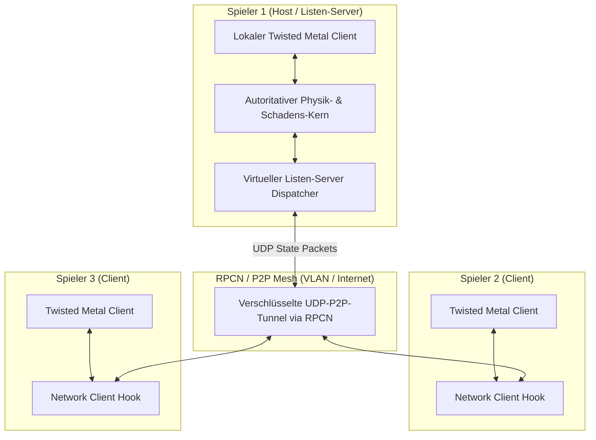

# Community-Konzept: Twisted Metal (2012) Multiplayer-Wiederbelebung via P2P Listen-Server

**Status:** Architekturvorschlag & Aufruf an die RPCS3- / Reverse-Engineering-Community  
**Bezug:** *Twisted Metal (PS3, 2012)* BCUS98106  
**Ziel:** Dauerhafte, serverlose Online-Spielbarkeit über RPCS3 / RPCN  

---

## 1. Die historische Problemstellung: Demonware & Server-Abschaltung

*Twisted Metal (2012)* war von Sony und Eat Sleep Play primär als hochkompetitiver Online-Multiplayer-Titel konzipiert. Die Netzwerkarchitektur basierte auf Sonys zentraler **Demonware-Infrastruktur**:
- Spieler authentifizierten sich über PSN-Tickets bei Demonware-Auth-Servern.
- Lobbys, Matchmaking, Statistiken und Ranglisten wurden auf zentralen Servern verwaltet.
- Matches liefen größtenteils über dedizierte Server-Instanzen oder von Demonware koordinierte Knoten.

Im Januar 2019 schaltete Sony die Server für *Twisted Metal* endgültig ab. Seitdem ist der Online-Modus im Hauptmenü tot; Versuche, ein Spiel zu hosten oder einer Lobby beizutreten, enden mit Timeout-Fehlern. Ein Spiel, das zu den besten Fahrzeug-Arenakämpfen aller Zeiten gehört, ist seither auf reines Splitscreen- und Bot-Match-Gameplay beschränkt.

---

## 2. Warum bisherige Emulationsansätze scheiterten

1. **Komplexität des Demonware-Protokolls:**  
   Die proprietären Protokolle von Demonware erfordern verschlüsselte Handshakes, dynamische Session-Tokens und komplexe Matchmaking-Strukturdaten. Ein vollwertiger Nachbau privater Demonware-Masterserver erfordert enormen Wartungsaufwand, Serverkosten und Reverse-Engineering-Ressourcen.
2. **Fehlende dedicated Server-Binaries:**  
   Im Gegensatz zu PC-Spielen stehen der Community keine offiziellen Server-Dateien zur Verfügung.
3. **RPCN-Grenzen bei dedizierter Server-Architektur:**  
   RPCN (RPCS3s quelloffener PSN-Ersatz) emuliert erfolgreich Sonys grundlegende PSN-Dienste (Freundeslisten, Einladungen, Socket-Kommunikation), kann jedoch ohne spielspezifischen Code keine dedizierten Drittanbieter-Server ersetzen.

---

## 3. Die Lösung: Host-basierte P2P Listen-Server Architektur

Anstatt einen teuren, wartungsintensiven zentralen Server zu betreiben, schlagen wir eine **P2P Listen-Server-Modifikation** vor, die vollständig innerhalb von RPCS3 und dem Spielcode greift:

### Funktionsprinzip:
1. **Der Host als Spielserver:**  
   Ein Spieler erstellt im Menü ein Spiel. Ein PPU-Hook leitet den Matchmaking-Flow um: Statt einen externen Demonware-Server anzufragen, initialisiert die PPU die interne Server-Schleife der Spiel-Engine lokal auf der Host-Maschine.
2. **RPCN als Matchmaking-Lobby:**  
   RPCN übernimmt lediglich die Vermittlung: Über die RPCN-Lobby-API sieht jeder befreundete Spieler, welches Spiel offen ist, und kann direkt per IP/NAT-Traversal beitreten.
3. **P2P-Zustandssynchronisation:**  
   - Alle Fahrphysik-, Raketenflug- und Kollisionsentscheidungen laufen autoritativ auf dem Host.
   - Die Clients senden lediglich Controller-Inputs (Gas, Lenkung, Waffenauswahl) an den Host.
   - Der Host sendet Delta-komprimierte Zustands-Pakete (Positionen, Geschwindigkeiten, HP) mit 30/60 Hz an alle Clients.

---

## 4. Konkrete Implementierungs-Schritte für die Community

### Schritt 1: Demonware Auth & Matchmaking Bypass (PPU-Ebene)
- Auffinden der PPU-Funktionen, die den Verbindungsaufbau zu `demonware.net` initiieren (im PPU-Modul `BCUS98106`).
- Ersetzen der Authentifizierungsprüfungen durch lokale Mock-Erfolgsmeldungen (`return 0` / Erfolgsstatus).
- Umleiten des Menü-Punkts *Host Game* auf die lokale LAN-/Listen-Server-Initialisierungsroutine, die im Code des Spiels bereits als Debug- oder LAN-Rest vorhanden ist.

### Schritt 2: Sockets auf RPCN P2P Socket-Layer abbilden
- In RPCS3 leitet die Socket-Emulation (`sys_net`) Anfragen über das RPCN-Netzwerk weiter.
- Durch das Eintragen eines standardisierten Ports (z. B. UDP `3658`) können Spieler ohne Port-Forwarding (mittels UPnP oder STUN über RPCN) direkt miteinander verbunden werden.

### Schritt 3: Entkopplung der Latenzkompensation (Client-Side Prediction)
- *Twisted Metal* besitzt ein extrem schnelles Gameplay. Reine Host-Simulation ohne Vorhersage würde bei Latenzen > 40 ms zu spürbarer Verzögerung beim Lenken führen.
- Client-Side Prediction: Der Client berechnet die Bewegung des eigenen Autos lokal sofort vor und korrigiert sie nur bei Abweichungen durch Host-Kollisionen.

---

## 5. Aufruf an die Modding- & RPCS3-Community

Die 4K-Grafik und die 60-FPS-Stabilität sind gelöst. Das Spiel läuft schöner und stabiler als jemals auf der Original-Hardware. Nun fehlt nur noch ein letzter, entscheidender Baustein, um *Twisted Metal (2012)* unsterblich zu machen: **Der Online-Multiplayer**.

Wir rufen alle versierten Reverse-Engineers, Netzwerk-Spezialisten und RPCS3-Entwickler auf:
- Nutzt die in diesem Dossier gesicherten PPU- und SPU-Analysemethoden.
- Helft mit, die Netzwerk-Dispatch-Tabellen im PPU-Dump zu lokalisieren.
- Lasst uns gemeinsam diesen legendären Titel wieder auf die Renn- und Schlachtpisten des Internets bringen!
