# Twisted Metal (2012) – Native 4K 60FPS Remaster

🌐 **Language:** [English](README.md) | [Deutsch (German)](README.de.md)

---

### ⬇️ Quick Links & Actions
* ⬇️ **Download & Automated Build:** [02_PROMPT_FUER_KI_NEUBAU.md](02_PROMPT_FUER_KI_NEUBAU.md) *(Master-Prompt for AI Agents)*
* ❤️ **Support the Project:** [Donate via PayPal](https://www.paypal.me/FedorTempel)
* 🎬 **Gameplay Trailer:** [Watch on YouTube Channel (FreddysHub)](https://www.youtube.com/channel/UCuaFl468uckb1ayU8lqgaQQ) *(Off-screen iPhone live recording)*

---

> [!IMPORTANT]
> ## ❤️ Support My Twisted Metal Modding Project
> 
> I've recently started modding **Twisted Metal**, a game I'm a huge fan of, and I'm really enjoying the process! I'd love to keep improving the game, explore a potential **PC port**, and work on more **PlayStation 3 games** in the future.
> 
> However, the AI models I use for development cost money, and more powerful models are even more expensive.
> 
> If you'd like to help me access better AI models and continue working on these projects, you can support me with a small, completely voluntary donation:
> 
> 👉 **PayPal:** [https://www.paypal.me/FedorTempel](https://www.paypal.me/FedorTempel)
> 
> *Every bit of support is greatly appreciated! Thank you! 🎮*

---

## 🧭 Visual Workflow & Pipeline (Mindmap)

```mermaid
flowchart TD
    subgraph REQ["1. PREREQUISITES (What you need)"]
        V1["Twisted Metal PS3 Disc / ISO (BCUS98106 - USA)"]
        V2["Official Sony PS3 Game Updates (v01.01 to v01.06)"]
        V3["Windows 10/11 PC + Dedicated GPU (NVIDIA RTX / AMD Radeon RX / Intel Arc)"]
        V4["Build Tools: VS Build Tools 2026, Qt 6.9, CMake 3.28+, Python 3"]
    end

    subgraph PROMPT["2. RECOMMENDED INSTALLATION (AI Master-Prompt)"]
        P1["Copy Master-Prompt (02_PROMPT_FUER_KI_NEUBAU.md)"]
        P2["Paste into an AI Agent (e.g. ChatGPT Codex or Gemini Antigravity)"]
    end

    subgraph PIPELINE["3. WHAT THE AI EXECUTES FULLY AUTONOMOUSLY"]
        S1["Phase 1-2: Clone clean RPCS3 & apply TM4K Vulkan shaders / core patch"]
        S2["Phase 3: Compile Release x64 (rpcs3.exe) & run windeployqt"]
        S3["Phase 4: Place 5x TM4K Flags & configure 4K (300% Scale, Async Texture: false)"]
        S4["Phase 5: Activate SPU/PPU Patches (11x NOP SPU-Bypass at 0x0066aaf4)"]
        S5["Phase 6: Execute Asset Patcher (5,000m draw distance & anti-blur in times.psarc)"]
        S6["Phase 7: Generate Launcher Script (Start-TwistedMetal-4K.ps1) with 7x EnvVars"]
        S7["Phase 8: Automated 8-point system validation (Verify-TM4K-Setup.ps1)"]
    end

    subgraph READY["4. SUCCESS: LAUNCH & ENJOY"]
        R1["Release v1.0: 4K UHD Master (3840x2160, up to 60 FPS)"]
        R2["(Native 1080p/1440p handheld profiles following in roadmap updates)"]
        R3["Under RPCS3 'Pads' select your controller (Xbox / PS5 / PC)"]
        R4["Experience Twisted Metal in native brilliance & 5km draw distance!"]
    end

    REQ --> PROMPT
    PROMPT --> S1
    S1 --> S2
    S2 --> S3
    S3 --> S4
    S4 --> S5
    S5 --> S6
    S6 --> S7
    S7 --> R1
    R1 --> R2
    R2 --> R3
    R3 --> R4
```

---

## ⚡ Recommended Installation: The AI Master-Prompt!

> [!TIP]
> **We strongly recommend installing this project via the Master-Prompt for AI Agents:**  
> 👉 **[02_PROMPT_FUER_KI_NEUBAU.md](02_PROMPT_FUER_KI_NEUBAU.md)**
>
> While a manual step-by-step developer guide is included for reference, the **AI Master-Prompt** has been rigorously field-tested and cross-verified against **two completely independent AI systems**:
> 1. **Google DeepMind Gemini (Gemini 3.1 Flash / Antigravity)**
> 2. **OpenAI ChatGPT Codex (Codex SOL 6.1)**
>
> Both agents successfully cloned, patched, compiled, configured, and verified this entire 4K remaster build on fresh environments completely autonomously without any human code intervention!

---

## 🎮 Prerequisites & Game Versions

1. **Game Version:**  
   * **Twisted Metal (PS3)** – US Release (Product Code: `BCUS98106`).
2. **Official Sony Game Updates (v01.01 to v01.06):**  
   * The game must be updated to version **v01.06**.
   * Updates can be downloaded legally via Sony's official content servers (or in RPCS3: Right-click game ➔ *Manage Game Patches* / *Check for Updates*) and installed as `.pkg`.
   * *Background:* Our 11x NOP SPU bypass (`0x0066aaf4`), 60 FPS patch, and draw distance deltas are mathematically aligned with version 01.06's `EBOOT.BIN`.
3. **Hardware:**  
   * Modern 6+ core CPU (AMD Ryzen or Intel Core).
   * Dedicated GPU with Vulkan 1.3 support (NVIDIA GeForce RTX, AMD Radeon RX, or Intel Arc).
4. **Build Environment (utilized autonomously by the AI):**  
   * Visual Studio 2026 Build Tools (C++ x64 toolchain)
   * CMake 3.28+
   * Qt 6.8+ or 6.9+
   * Python 3.10+

---

## 🎯 Release v1.0 Focus: 4K Master & Resolution Roadmap

* **4K UHD Master Standard (v1.0):**  
  The current release is the fully verified **4K Reference Master** (`Resolution Scale: 300` = 3840×2160). All TM4K custom compute shaders, draw distance deltas, and HDR bloom fusion pipelines are perfectly synchronized here.
* **For 1080p and 1440p Monitors (Super-Sampling / SSAA):**  
  If you have a 1080p or 1440p display, you can run the 4K version directly on your PC GPU! RPCS3 renders internally at 4K and downsamples the image to your native display resolution with magnificent **Super-Sampling Anti-Aliasing (SSAA)**. This eliminates all edge flickering on power lines and fences while preserving every advanced shader effect.
* **Roadmap for Mobile Handhelds (Steam Deck / ROG Ally / Legion Go):**  
  Dedicated native performance profiles for 1080p and 1440p with downscaled compute shaders tailored for mobile APUs are currently in development and will be released in upcoming updates.

---

## 🎮 Controller Configuration: Individual & Safe

* **Preserving Existing Profiles:**  
  The system never overrides existing RPCS3 controller setups. If you already use RPCS3, your custom controller and wheel mappings remain untouched.
* **First-Time Setup:**  
  Under `Pads` in RPCS3, simply assign your controller (`Player 1` ➔ `Handler: XInput` / `DualSense` ➔ select your device ➔ `Save`).
* **Protection Against Disconnects:**  
  RPCS3 is closed via the regular GUI window and never abruptly terminated with `--no-gui`. This prevents phantom device handles in the Windows kernel, which previously caused wireless controllers (e.g. Xbox Wireless Controller) to shut down after 3 seconds. If your controller ever disconnects: simply run `Restart-Service XboxGipSvc, GameInputRedistService` in PowerShell (no PC reboot needed!).

---

## 🎬 Gameplay Video & Live Proof
* **YouTube Video:** [Official Gameplay Trailer on YouTube (FreddysHub)](https://www.youtube.com/channel/UCuaFl468uckb1ayU8lqgaQQ)
* *Note on Capture:* The footage was recorded authentically off-screen directly with an iPhone from the monitor. No artificial emulator capture tricks—just genuine, unedited proof of real-time responsiveness, zero input lag, and rock-solid 60 FPS 4K gameplay on physical hardware!

---

## 💬 Personal Foreword: The Power of AI Agents

> *"I am not a programmer. I never learned C++ and I didn't even install RPCS3 myself—the AI agents did all of that. What I had was a vision, deep passion for Twisted Metal, and endless perseverance.*
>
> *For over three weeks, day after day, I poured hours into this project. I ran countless test sessions, observed every micro-detail, and pieced together the puzzle: subtle noise on desert sand, asphalt pop-in during high-speed turns, the 30Hz flicker on Sweet Tooth's burning mask, cyan color shifts, and phantom wireless controller disconnects.*
>
> *I relayed these observations back to the agents, formulated hypotheses with them, tested solutions, and iteratively refined the code.*
>
> *Some might think: 'This was just made with AI, so there is no real effort in it.' I strongly disagree: Behind this remaster are weeks of intense human testing, problem-solving, stamina, and real money spent on AI compute credits.*
>
> *Huge respect and gratitude go to **Google DeepMind Antigravity (Gemini)** and **OpenAI ChatGPT Codex**! Autonomous agents are the absolute future of gaming and modding. They empower fans like me to achieve things that once required entire game studios."*

---

## 📌 Complete Project Documentation Directory

1. **[00_START_HIER.md](00_START_HIER.md)** (German Overview / Deutsche Einstiegsseite)
2. **[00_ARCHITEKTUR_UND_KOMPONENTEN_ZUORDNUNG.md](00_ARCHITEKTUR_UND_KOMPONENTEN_ZUORDNUNG.md)** 🗺️  
   *The 5-Pillar Architecture & Component Atlas:* Exact mapping of every module, GPU compatibility matrix (NVIDIA/AMD/Intel), and comprehensive symptom diagnosis guide.
3. **[01_PROJEKTCHRONIK_UND_HISTORIE.md](01_PROJEKTCHRONIK_UND_HISTORIE.md)**  
   *Complete Project History:* Chronicling all milestones from early crashes to final 8-point automated validation.
4. **[02_PROMPT_FUER_KI_NEUBAU.md](02_PROMPT_FUER_KI_NEUBAU.md)** ⭐⭐ *(RECOMMENDED)*  
   *Turnkey Master-Prompt for AI Agents:* The verified prompt to build the entire remaster from scratch.
5. **[TESTLAUF_PROMPT_FRISCHER_PC.md](TESTLAUF_PROMPT_FRISCHER_PC.md)**  
   *Clean PC Test-Run Prompt:* Specialized prompt for independent verifications.
6. **[03_MANUELLE_SCHRITT_FUER_SCHRITT_ANLEITUNG.md](03_MANUELLE_SCHRITT_FUER_SCHRITT_ANLEITUNG.md)**  
   *Manual Step-by-Step Guide:* C++ developer build instructions, toolchains, and YAML switches.
7. **[04_MULTIPLAYER_KONZEPT_P2P_LISTENSERVER.md](04_MULTIPLAYER_KONZEPT_P2P_LISTENSERVER.md)**  
   *Community Multiplayer Revival Concept:* Technical analysis of Sony Demonware servers and P2P listen-server architecture via RPCS3/RPCN.
8. **[YOUTUBE_VIDEO_METADATEN.md](YOUTUBE_VIDEO_METADATEN.md)**  
   *YouTube Metadata Package:* Video titles and full English description templates.

---

## 📂 Repository File Structure

- **`03_QUELLCODE/`**:
  - `tracked-changes.patch` (Git patch for 11 RPCS3 core files on base commit `1707d7fc883ef48ff21bdcbb0141a3211ae09cb2`)
  - `overlay/` (All `TM4K*.hpp` shader headers and Vulkan present routines)
  - `flags/` (The 5 activation flags for 4K compute shaders)
  - `configs/` (Game-tuned `config_BCUS98106.yml` and patch definitions)
  - `apply_times_ngp_delta.py` & `times_ngp_deltas.json` (Standalone 5,000m asset patcher)
  - `Verify-TM4K-Setup.ps1` (Automated 8-point system validation script)
- **`04_RELEASE_SNAPSHOTS/`**: Checksum inventories and candidate hashes (`candidate-hashes.json`).
- **`05_PRUEFSUMMEN/`**: Full SHA256 checksum audit trail.
- **`06_ZUSATZBELEGE/`**: Reference hardware profiles and Windows AutoHDR configurations.
