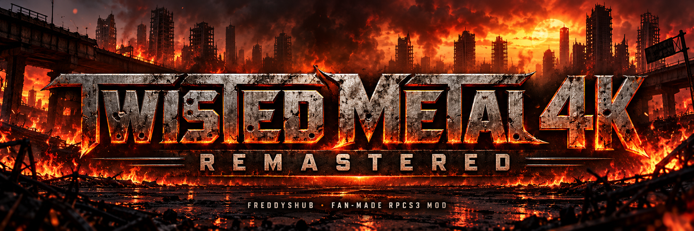
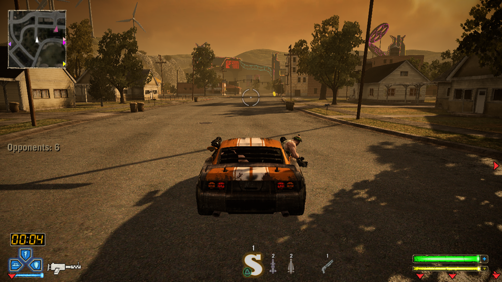
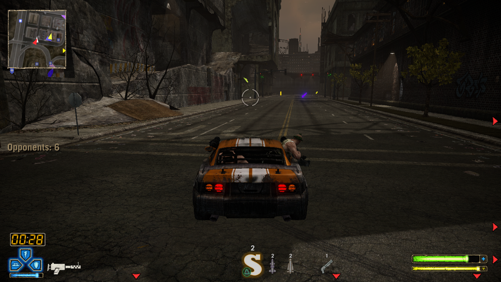

  

  <b>A fan-built rendering &amp; performance project for Twisted Metal (2012) on RPCS3.</b> 
  Sharper scene reconstruction. Longer-range detail. A documented path to rebuilding it yourself.

  
  
  

  <a href="BUILD.md"><b>Build the mod</b></a> ·
  <a href="docs/TECHNICAL_NOTES.md">How it works</a> ·
  <a href="docs/REPRODUCTION.md">Test evidence</a> ·
  <a href="https://github.com/FreddysHub/Twisted-Metal-4K-Performace-MOD/issues">Report a bug</a> ·
  <a href="README.de.md">Deutsch</a>

> [!IMPORTANT]
> **Source/build package, not a ready-to-play game download.** Bring your own legally obtained game, matching update and PS3 firmware. This is an experimental community modification, not an official RPCS3 or Sony release. Performance and compatibility depend on hardware, scene and cache state; 60 FPS is a target, not a guarantee.

**Game not included:** you must own and provide your own matching Twisted Metal
(PS3) game dump. This repository does not supply or link to game downloads,
game updates, decryption keys or PS3 firmware files.

[Privacy review and the game-file boundary](docs/PRIVACY.md).

## Built for the details

| Area | What this project changes |
| --- | --- |
| **Scene clarity** | Custom Vulkan compute passes combine higher-resolution scene detail with the game's lower-resolution colour/presentation buffers. |
| **Performance** | A selective 11-instruction PostFX bypass, the community 60 FPS patch and an SPU MLAA-disable patch work alongside renderer modifications. |
| **Distant detail** | Targeted `times.ngp` edits extend eligible small-object LOD thresholds in the Times archives, without globally forcing every model to its near LOD. |
| **Presentation** | Matched scene/overlay cropping removes the inset border; frame-pairing, colour and particle paths address issues seen during testing. |
| **Rebuilding** | Pinned RPCS3 source, tracked patch, eight custom headers, five activation flags, configuration and an asset-delta patcher. |

**What “4K” means:** 3840 × 2160 is **8,294,400 output pixels**, at 300% scale relative to 1280 × 720. This does not turn every source texture, shadow map, movie or material into an 8.3-megapixel asset. Some inputs remain lower-resolution. No replacement AI texture pack is included.

## From the development bench

<table>
  <tr>
    <td></td>
    <td></td>
  </tr>
  <tr><td align="center">Daylight environment · frame 3698</td><td align="center">City environment · frame 6060</td></tr>
</table>

Existing **development RenderDoc replay exports**, displayed at 1920 × 1080. Not new captures of the latest rebuild, not a before/after comparison, and not proof of frame rate. [Image provenance](docs/assets/README.md).

🎬 **[FreddysHub on YouTube](https://www.youtube.com/channel/UCuaFl468uckb1ayU8lqgaQQ)** — gameplay channel. A specific public trailer URL has not yet been verified.

## Get started

1. **Check the game:** US `BCUS98106`, update `01.06`, matching PPU hash. Other releases are not validated here.
2. **Use an isolated build:** follow the [English build guide](BUILD.md). Preserve your working emulator and saves.
3. **Validate and play-test:** check logos, menu, vehicles, flames, driving and distant geometry on your PC.

There is **no precompiled release attached** at this publication checkpoint. GitHub's source ZIP contains sources and instructions, not `rpcs3.exe`, the game or firmware.

<b>Developer reference: baseline and critical settings</b>

- RPCS3 base: `1707d7fc883ef48ff21bdcbb0141a3211ae09cb2`.
- Game PPU: `6bb4db395550102f567fb7b1dbbf81583417150f`.
- Vulkan, `Resolution Scale: 300`, `Shader Mode: Async Recompiler (multi-threaded)`.
- Keep `Raw 4K Scene` and global `Model LOD Distance` / `Force Near Model LOD` experiments **disabled**.
- Use all five flags and seven launcher environment settings.
- `/MT` LLVM libraries require a consistent static MSVC runtime.
- No Windows GPU driver is modified. Windows Auto HDR is separate from renderer colour reconstruction.

## Evidence, not promises

A separate source rebuild on the development PC passed **38 compute-shader variants**, **46 recipe/runtime checks** and a loader test; both generated Times archives matched their expected hashes. Installed toolchains and dependencies were used, so this is **not** a completely fresh-machine certification.

Later Test 4 notes report menu startup and user gameplay, including initial visual issues. These are distinct runs, not a cross-vendor certification or a full campaign/stability benchmark. [Evidence and limits](docs/REPRODUCTION.md).

Please report build, CPU/GPU/driver, scene and cache state. Do not upload game data, saves, credentials or multi-gigabyte captures to an issue. [Contribution guide](CONTRIBUTING.md).

## Documentation

| Start here | Reference |
| --- | --- |
| [Build & install](BUILD.md) | [Renderer, PostFX, LOD and pixel counts](docs/TECHNICAL_NOTES.md) |
| [Reproduction evidence](docs/REPRODUCTION.md) | [Publication audit / corrections (DE)](docs/PUBLICATION_AUDIT.de.md) |
| [German overview](README.de.md) | [Detailed German manual](03_MANUELLE_SCHRITT_FUER_SCHRITT_ANLEITUNG.md) |
| [AI rebuild prompt (DE)](02_PROMPT_FUER_KI_NEUBAU.md) | [Historical chronology](01_PROJEKTCHRONIK_UND_HISTORIE.md) |

Older notes can contain superseded hypotheses. The current build guide and publication audit take precedence.

## The people behind the project

**FreddysHub** initiated the project, directed testing and repeatedly checked the game on real hardware. AI-assisted research, coding and analysis involved **Google Gemini / Antigravity** and **OpenAI ChatGPT / Codex**.

The foundation is the **RPCS3 team and contributors**. Patch definitions credit **illusion** (60 FPS; research referenced by local PostFX work) and **Whatcookie** (SPU MLAA). **RenderDoc** enabled GPU-frame inspection. This disclosure is not endorsement by those projects.

### Support the next test

Voluntary support helps fund testing and development:

**[Support via PayPal](https://www.paypal.me/FedorTempel)** · **[YouTube](https://www.youtube.com/channel/UCuaFl468uckb1ayU8lqgaQQ)**

No donation is required. Ports, multiplayer work and handheld profiles are ideas, not promised deliverables.

---

[LICENSE](LICENSE) · [Credits and rights notices](NOTICE.md). No game files, firmware or emulator binaries are distributed in this source package.
